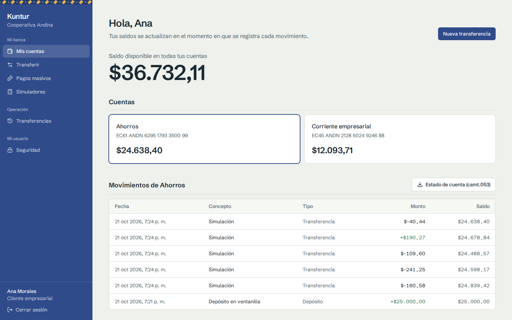
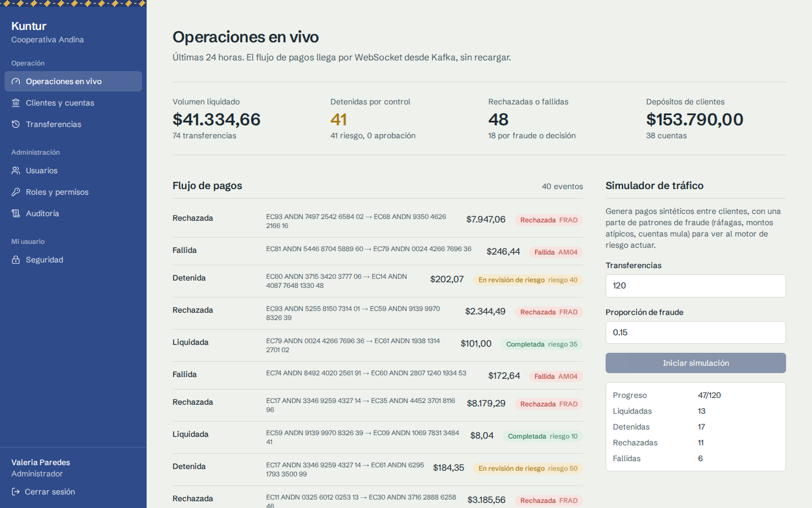
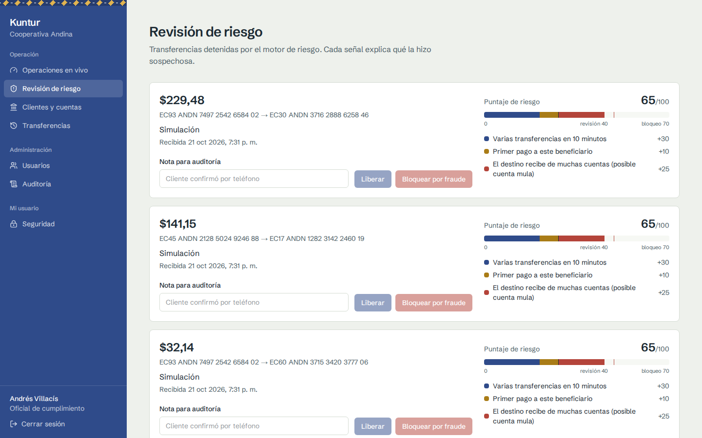
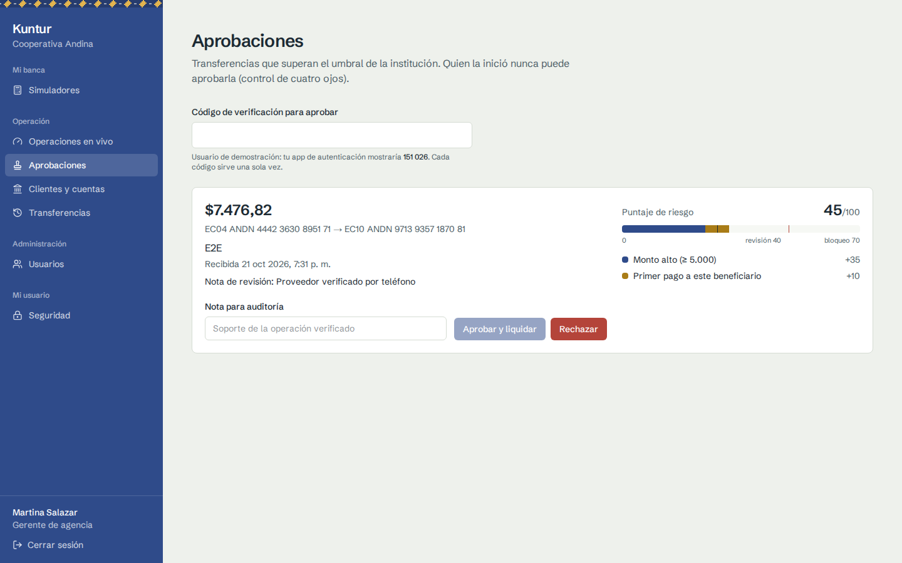
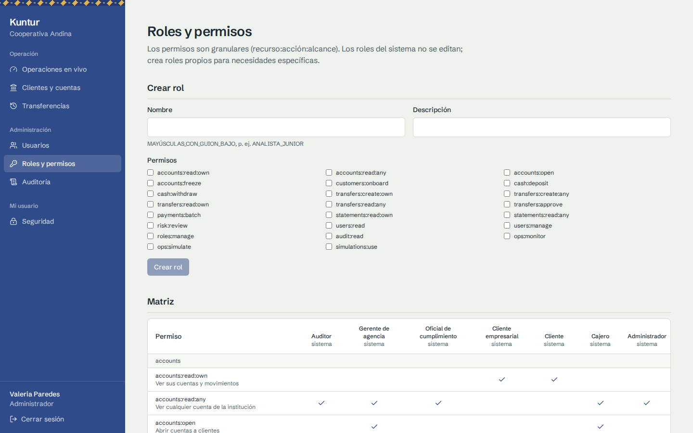
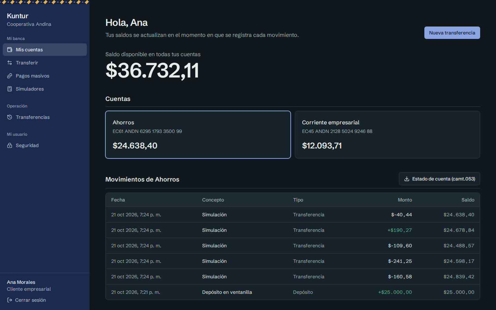
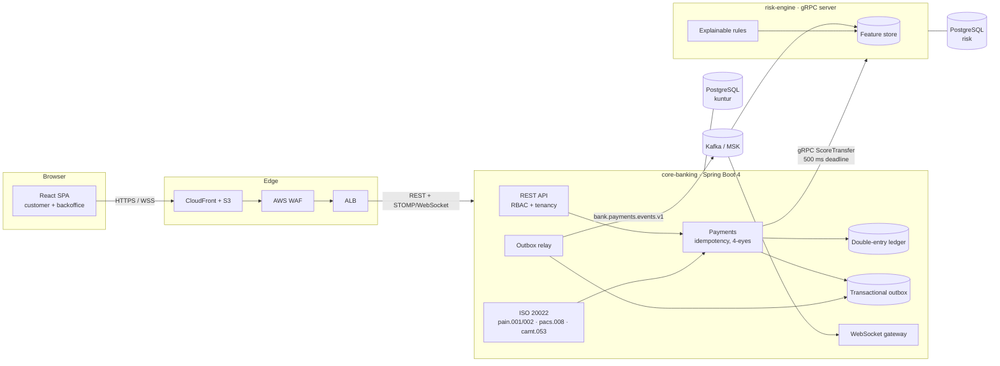

# Kuntur: core banking for cooperatives and fintechs

*Kuntur* is Kichwa for the Andean condor.

Kuntur is a multi-tenant core banking platform: one deployment serves many financial institutions (credit
unions, fintechs), each fully isolated. It books money on a double-entry ledger, speaks **ISO 20022**, scores
every payment in real time with an explainable risk engine, and enforces four-eyes control on high-value
operations.

It is a portfolio project. It is also built the way a regulated system has to be: the database refuses
overdrafts, the audit trail detects tampering, and every endpoint names the permission it requires.

```
docker compose up --build        # then open http://localhost:8088
```

Every demo user's password is `Kuntur2026!`. The login screen offers one-click role switching, so you can see
how the product changes per role: customer, corporate customer, teller, branch manager, compliance officer,
auditor, institution admin and platform operator. The branch manager (`gerente@andina.ec`) has two-factor
authentication on; as a demo user, the screen shows the code an authenticator app would display.

| | |
|---|---|
|  |  |
| Customer banking: balances and movements, live | Live operations: payments arrive over WebSocket while the simulator injects fraud patterns |
|  |  |
| Risk review: every point of the score is explained | Four-eyes approval: needs a second person *and* a fresh MFA code |
|  |  |
| 24 granular permissions × 8 system roles, plus custom roles | Dark mode with its own palette, not an automatic inversion |

---

## Architecture



| Protocol | Used for | Why this one |
|---|---|---|
| **REST** | Public API for the web app and integrators | Universal, cacheable, documented with OpenAPI (`/swagger-ui.html`) |
| **gRPC** | core-banking → risk-engine scoring, synchronous in the payment path | Typed contract (`proto/`), HTTP/2, hard deadlines, ~ms latency |
| **Kafka** | Domain events (`TransferCompleted`, `TransferRejected`, …) | Decouples consumers: the risk feature store and real-time push evolve independently. Poison events go to a dead-letter topic instead of being skipped |
| **WebSocket (STOMP)** | Live notifications to customers, live operations feed to staff | Server push without polling; fan-out across replicas via Kafka |

A **modular monolith** plus one extracted service is a deliberate choice ([ADR-0001](docs/adr/0001-modular-monolith-plus-risk-service.md)).
Money movement needs ACID transactions across accounts, ledger, transfer state and outbox. The risk engine
has a different scaling profile, release cadence and data model, so it is a separate service.

---

## What it does

### For customers
- **Accounts and movements:** balances update live, and a camt.053 statement downloads in one click.
- **Transfers:** IBAN-style account numbers with ISO 13616 check digits, so a typo is caught before any money moves. Every transfer is idempotent: retries and double clicks never pay twice.
- **Bulk payments (corporate):** upload a **pain.001** payroll/supplier file and get back a **pain.002** report with the status and ISO reason code of every payment.
- **Financial simulators:**
  - Loan amortization (French and German systems, with credit-life insurance and effective annual rate)
  - Term deposit (360-day year, withholding tax)
  - Savings goal planner
  - Borrowing capacity based on debt-to-income

### For the institution (backoffice)
- **Live operations:** 24-hour KPIs plus a real-time payment feed over WebSocket. A **traffic simulator** injects synthetic payments with fraud patterns (velocity bursts, amount spikes, mule accounts) to watch the risk engine react.
- **Risk review queue:** every held payment shows an *explainable* risk meter, i.e. which signal added how many points against the review and decline thresholds.
- **Four-eyes approvals with step-up MFA:** transfers above the institution's threshold wait for a second person, who must also enter a fresh code from their authenticator app. Whoever initiated a transfer can never approve it (enforced in the domain model and covered by tests).
- **Customers and teller operations:** KYC onboarding, cash deposits and withdrawals, account freezing.
- **Users, roles and permissions:** a permission matrix with 24 granular permissions (`resource:action:scope`), 8 system roles and custom roles.
- **Tamper-evident audit trail:** SHA-256 hash chain with one-click integrity verification.

### For the platform operator
- **Institution provisioning:** creating a tenant atomically creates its roles, cash vault account and first administrator.

---

## Engineering highlights

**Money correctness**
- Double-entry ledger: every journal entry nets to zero, amounts are `bigint` minor units, and postings are append-only (a database trigger rejects `UPDATE`/`DELETE`).
- Overdraft is impossible twice over: the domain checks the balance under a row lock, and a database `CHECK` constraint backs it up.
- Accounts are locked in primary-key order, so concurrent A→B and B→A transfers cannot deadlock. A test fires 20 concurrent transfers at an account that can afford 10: exactly 10 succeed and the balance ends at 0.00.
- Idempotency keys are scoped per user and fingerprinted by payload. A reused key with a different body gets `422`.
- A crash-recovery sweep re-drives transfers that were accepted but not yet booked. Booking is idempotent.

**Security (RBAC, multi-tenancy, DevSecOps)**
- Stateless RS256 JWT access tokens (10 min) carry the effective permissions.
- Refresh tokens are opaque and stored hashed. They rotate on every use with **reuse detection**: replaying an old token revokes the whole session family (OAuth 2.0 Security BCP).
- Login has a per-IP rate limit, per-user lockout, and constant-time handling of unknown emails. Passwords are BCrypt.
- **Two-factor authentication (TOTP, RFC 6238)** with self-service enrollment, implemented on the JDK. Approving a high-value transfer needs a fresh, **single-use** code (step-up), so a stolen session alone cannot move money. Wrong codes count towards the lockout ([ADR-0008](docs/adr/0008-totp-mfa-and-step-up.md)).
- Multi-tenancy uses a shared schema and Hibernate `@TenantId`, and is **fail-closed**: with no tenant bound, queries match nothing. Cross-tenant access must opt in to an explicit system scope ([ADR-0002](docs/adr/0002-multi-tenancy-shared-schema.md)).
- Ownership-aware authorization (`accounts:read:own` vs `accounts:read:any`). A resource you may not see returns `404`, not `403`, so IDs cannot be enumerated.
- An architecture test fails the build if any endpoint lacks `@PreAuthorize` or references a permission that does not exist.
- XML parsing is hardened against XXE (covered by a test). Problem details follow RFC 9457 and never leak internals. The SPA has a strict CSP, and nginx/CloudFront add the security headers.

**Supply chain and pipeline** (`.github/workflows`)
- CodeQL (Java, TypeScript, Actions), gitleaks, Trivy (dependencies, secrets, IaC, images), dependency review with a license policy, and an OWASP ZAP baseline (DAST) against the full stack.
- CycloneDX SBOM per build. Images get an SPDX SBOM, are signed keylessly with **cosign**, and are verified before promotion to AWS.
- Every action is pinned by commit SHA, runners are hardened, and permissions are least-privilege per job. Dependabot covers all 5 ecosystems.

**Performance, measured** (`make load`: k6 → nginx → core-banking → gRPC risk engine → PostgreSQL + Kafka, all on one laptop)

| Load (transfers/s, sustained) | p50 | p95 | p99 | Errors |
|---|---|---|---|---|
| 100 | 10 ms | 18 ms | 30 ms | 0 % |
| 150 | 10 ms | 81 ms | 155 ms | 0 % |

Every request is a full transfer: idempotency check, real risk scoring over gRPC, a double-entry booking under
row locks, an audit hash-chain entry and an outbox event. Two findings from load testing are fixed and documented
in the code:
- **Virtual threads are off on purpose**: on Java 21, blocking inside `synchronized` code in the JDBC, gRPC and Kafka clients *pins* virtual threads to their carrier threads. At 140 transfers/s, p95 was 4.8 s with virtual threads and 27 ms without. They should be re-enabled on Java 24+ (JEP 491).
- **A stale-entity bug turned concurrent teller deposits into 409s**: 9 of 12 failed, because the deposit and the cash vault were read before being locked. The ledger now locks by re-reading rows `FOR UPDATE`, and `CashIntegrationTest` covers it.

**Testing**
- 109 backend tests: unit, architecture, and integration against real PostgreSQL and Kafka (Testcontainers), including concurrency (20 parallel transfers against one balance, 12 parallel deposits against one vault) and a poison-message test for the dead-letter topic.
- 11 Playwright end-to-end tests against the full Docker stack, run in CI:
  - a transfer that goes through risk review, compliance release, and then four-eyes approval with an MFA step-up;
  - live WebSocket delivery to both the ops feed and the receiving customer;
  - RBAC and tenant isolation;
  - no horizontal overflow on any page, on desktop and on mobile.
- 10 front-end unit tests, including the browser TOTP against the RFC 6238 vectors (the same vectors as the server).

**Observability**
- Structured ECS JSON logs, Prometheus metrics (`kuntur.transfers.*`, `kuntur.risk.latency` p95/p99, outbox throughput) and OpenTelemetry tracing.
- `docker compose --profile observability up` adds Prometheus and a provisioned Grafana dashboard.

**Infrastructure as code** (`infra/terraform`, validated with `terraform validate`, tflint and Trivy; nothing is deployed)
- VPC with public, private and isolated data subnets; flow logs; VPC endpoints. Application tasks have **no internet egress**.
- ECS Fargate on ARM64 (Graviton): read-only root filesystem, non-root user, all Linux capabilities dropped, Service Connect for gRPC, deployment circuit breaker with automatic rollback, CPU autoscaling.
- RDS PostgreSQL 17: Multi-AZ, KMS-encrypted, TLS enforced, IAM auth, master password managed and rotated by RDS in Secrets Manager.
- MSK Serverless with IAM auth.
- CloudFront + S3 (Origin Access Control) for the SPA. The ALB accepts traffic only from CloudFront's prefix list plus a secret origin header, and is protected by AWS WAF (managed rules plus a login rate limit).
- GitHub OIDC deploy role scoped to one repository and environment, so no AWS keys exist anywhere. CloudWatch alarms go to SNS.

---

## Repository layout

```
proto/                    gRPC contract (risk/v1/risk.proto)
services/core-banking/    Spring Boot 4 · Java 21 · modules: platform, identity, accounts, ledger,
                          payments (+ iso20022, risk), simulations, realtime, ops, shared (security,
                          tenancy, audit, outbox)
services/risk-engine/     gRPC server, Kafka consumer, rule engine, feature store
web/                      React 19 · TypeScript · Vite · Tailwind · TanStack Query · STOMP · Playwright (e2e/)
infra/terraform/          modules/{network,data,ecs-service,edge,static-site,github-oidc,platform}
                          envs/{dev,prod} · bootstrap (remote state)
deploy/                   Postgres init, Prometheus, Grafana provisioning
load/                     k6 load test
docs/                     ADRs, threat model, ISO 20022 notes, sample pain.001
```

## Running and testing

| Command | What it does |
|---|---|
| `docker compose up --build` | Full stack with demo data on http://localhost:8088 |
| `./mvnw verify` | 109 backend tests (unit, architecture, and integration against real PostgreSQL + Kafka via Testcontainers), JaCoCo, SBOM |
| `cd web && npm ci && npm run lint && npm test` | ESLint (strict type-checked + a11y + security rules), Vitest |
| `make e2e` | Playwright end-to-end suite against the running stack |
| `make load` | k6 load test of the transfer path (`PEAK_RPS=150` by default) |
| `cd web && npm run screenshots` | Regenerates the README screenshots from the running stack |
| `cd web && npm run dev` | Front end with hot reload against a backend on :8080 |
| `make help` | Every shortcut, including Terraform validation and security scans |

## Documentation

- [Architecture decisions (ADRs)](docs/adr)
- [Threat model (STRIDE)](docs/threat-model.md)
- [ISO 20022 implementation notes](docs/iso20022.md)
- [Security policy](SECURITY.md)
